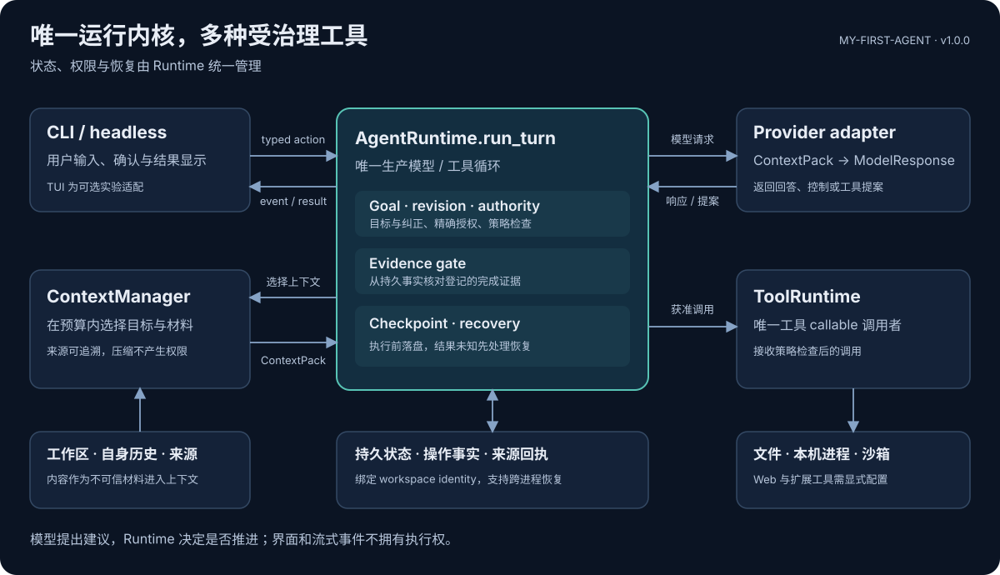
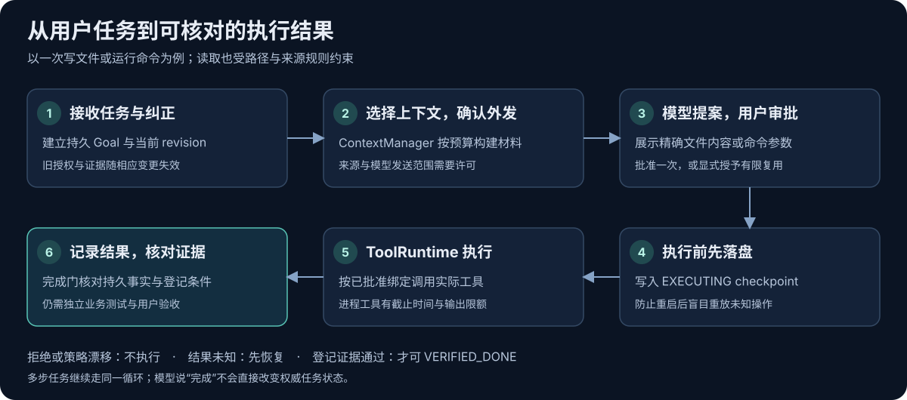

# my-first-agent

**一个在 macOS 本机工作的个人 AI Agent：用自然语言处理项目文件和本机任务，让执行、授权与恢复都有明确边界。**

它可以读代码、查材料、修改文件、运行测试，在需要时暂停、接受纠正，再从保存的状态继续。
这个项目把模型循环、工具执行、上下文管理和持久状态放在同一套运行内核里，面向单用户 CLI 日用。

**v1.0.0 · macOS · Python ≥ 3.11 · 功能开发已结束**

[快速开始](#快速开始) · [架构](#架构) · [能力与边界](#能力与边界) · [验证结果](#验证结果) · [文档](#文档)

## 能用它做什么

| 工作 | 使用方式 | 结果怎样核对 |
| --- | --- | --- |
| 理解项目 | 阅读文件，按路径、文本或行段检索，结合当前工作区历史回答 | 查看文件与行号来源，使用 `/sources` 回看 |
| 修改代码与文档 | 提出修改，审批后写入，继续读回与检查 | 查看 diff，运行已有测试和关键反例 |
| 执行本机任务 | 提交结构化命令，或经审批的 Shell / Seatbelt 沙箱命令 | 查看 executable、参数、工作目录、结果与退出状态 |
| 处理多步工作 | 明确任务后持续推进，在权限、预算或阻塞处停下 | 检查任务目标与登记的完成证据 |
| 纠正、暂停与恢复 | 在安全输入边界补充要求；`/pause`、`/resume` 或重启继续 | 任务版本、来源和执行结果保存在 checkpoint 中 |
| 整理有来源的材料 | 结合工作区文件、自身历史和可选公开 Web，形成带来源的说明 | 检查 Sources、产物和 citation sidecar |

例如，在项目副本里提出：

```text
请修复 app.py 中的 CSV 导出：空数据也要保留表头。
补上对应测试，运行 pytest -q，最后说明修改了什么、怎样验证。
```

模型负责理解任务和提出操作；是否允许执行、任务处于什么状态、证据是否满足条件，由 Runtime 判断。

## 架构



项目只有一套生产模型 / 工具循环：`AgentRuntime.run_turn`。CLI、headless 和可选 TUI
复用这套内核；只读 SubAgent 也复用同一 Runtime 实现。

| 部分 | 责任 | 源码入口 |
| --- | --- | --- |
| 组合根与交互适配 | 装配配置和能力，翻译用户决定，渲染结果 | [`main.py`](main.py)、[`agent/cli/`](agent/cli/) |
| Runtime | 推进 Goal 与 revision，检查策略、审批和完成证据，协调恢复 | [`agent/runtime/`](agent/runtime/) |
| ContextManager | 在预算内选择上下文，管理来源与压缩；压缩不能产生权限 | [`agent/runtime/context.py`](agent/runtime/context.py) |
| Provider adapter | 把 `ContextPack` 转为 `ModelResponse`，返回回答或提案 | [`agent/provider/`](agent/provider/) |
| ToolRuntime 与执行器 | 统一调用工具；文件、进程与沙箱各自承担执行边界 | [`agent/runtime/tools.py`](agent/runtime/tools.py)、[`agent/tools/`](agent/tools/)、[`agent/process/`](agent/process/)、[`agent/sandbox/`](agent/sandbox/) |
| 持久化与历史 | 保存事实和 checkpoint，绑定工作区身份，支持恢复与检索 | [`agent/continuity/`](agent/continuity/)、[`agent/history/`](agent/history/) |

Provider 不执行工具，界面不推进另一套任务状态机。Memory、Skill、MCP、浏览器等通过明确的扩展边界接入。
完整约束见 [Kernel Architecture](docs/architecture/KERNEL_ARCHITECTURE.md) 与
[Extension Contracts](docs/architecture/EXTENSION_CONTRACTS.md)。

## 一次操作怎样执行



- **执行许可**：写文件和运行命令需要批准。精确命令绑定 executable、argv、cwd、环境与资源策略；适用时可显式选择有限授权复用。
- **数据外发许可**：远端模型看到哪些内容需要确认。许可按目的地、模型、数据与来源绑定；密钥只从环境变量读取，不保存到配置或 checkpoint。
- **恢复**：执行前先写入 `EXECUTING` checkpoint。若无法确认工具结果，先请用户分类，不盲目重放可能已经发生的操作。
- **完成**：只有登记的 mandatory criteria 经持久事实核对后，才可显示 `VERIFIED_DONE`。它仍需要独立业务验收。

文件读取受工作区相对路径、no-follow、敏感路径拒绝和读取限额约束。
`local_process` 使用当前用户权限，**本身不是沙箱**；需要隔离时应审阅并选择相应 Seatbelt 策略。

## 快速开始

默认安装 base CLI。源码尚未发布到 PyPI；从仓库构建非 editable wheel：

```bash
git clone https://github.com/yaoziyaoguai/my-first-agent.git
cd my-first-agent

# python3 需要为 3.11+；收官核心验证使用 macOS / CPython 3.12.2。
python3 -m venv ~/.local/share/first-agent/venv
source ~/.local/share/first-agent/venv/bin/activate
python -m pip wheel --no-deps --wheel-dir dist .
python -m pip install dist/first_agent-1.0.0-py3-none-any.whl
```

重复构建已有工作树时，先清理该仓库自动生成的 `build/` 和 `first_agent.egg-info/`，
以免旧模块进入 wheel。详细步骤见 [进阶配置](docs/guides/advanced-configuration.md#开发环境与完整门)。

### 配置模型并启动

收官真实任务使用以下 DeepSeek 配置。`setup` 只保存非秘密参数，不发送模型请求：

```bash
first-agent setup \
  --provider openai_compatible --model deepseek-flash \
  --base-url https://api.deepseek.com \
  --credential-env DEEPSEEK_API_KEY --thinking-mode disabled

# 在自己的终端替换占位符；不要把真实 key 写入仓库。
export DEEPSEEK_API_KEY='your-api-key'
first-agent --workspace /absolute/path/to/your-project
```

此后可在任意项目目录直接运行 `first-agent`，沿用已保存配置。也可以运行
`first-agent setup` 交互配置。首次模型发送会展示外发范围，写入或命令执行前会展示审批。

**先准备任务项目的依赖。** 例如，要运行 pytest，先在项目自己的环境中安装并确认它可用。
激活项目的 `.venv` 后，可用 `~/.local/share/first-agent/venv/bin/first-agent` 启动。
进入 REPL 后，也可以用 `/env-path .venv/bin` 将该目录加入本会话 `local_process` 的
命令搜索路径。命令解析后仍须审批。沙箱与受管 Web 进程各自使用独立环境。

### 会话与确认

| 操作 | 用途 |
| --- | --- |
| `/help`、`/status` | 查看命令和权威任务状态 |
| `/pause`、`/resume`、`/cancel` | 暂停、继续或取消当前任务 |
| `/new`、`/switch` | 新建任务或选择本工作区非终态会话；活跃任务先暂停 |
| `/sources` | 查看当前材料与执行结果的来源 |
| `/project-path config/app.yaml` | 本会话明确开放一个保留名称的普通项目路径 |
| `/env-path .venv/bin` | 本会话为 `local_process` 添加工作区内 PATH 目录 |
| `/exit` | 退出当前 CLI，保留状态 |

审批提示中的 `y` 只批准本次操作；适用时 `f` / `d` 可选同文件 / 已声明目录的有限复用。
外发提示中的 `s` 授予常规对话许可，`r` 还覆盖符合来源证明条件的读类与命令输出。
复用有次数与时间上限，不能跳过不可复用来源的单次披露；
`/revoke-provider-consent` 和 `/revoke-goal-target` 可撤销对应许可。

默认状态位于工作区外的 `~/.local/state/my-first-agent/v1`。同一工作区与状态根重启后，
按恢复提示继续；不要删除 checkpoint 或锁文件来绕过未知效果。
会话路径准入在 `/new`、`/switch` 重装配或重启后重建。更完整的操作与故障处置见
[日用指南](docs/guides/daily-use.md)。

## 能力与边界

默认支持范围是 **macOS、单用户、本地 CLI、有用户参与审批的任务执行**。
其它平台、多用户服务和完全无人值守运行不属于本版承诺。

| 能力 | 启用方式 | 当前边界 |
| --- | --- | --- |
| 文件、检索、自身历史、上下文、任务与恢复 | base 默认提供 | 限当前工作区及绑定身份；不扫描其它应用的私人会话 |
| 本机命令、Shell、Seatbelt 沙箱 | base，执行时审批 | 有时限、输出限额与具体权限策略；普通本机命令无 OS 级沙箱 |
| 公开 Web | `first-agent setup-web`，自行提供 Tavily key | Search 和 Extract 的查询或 URL 经批准后发往 Tavily，使用独立于浏览器的配置 |
| 工作区 Memory / SubAgent | 显式 store / `--subagent` | Memory 为本地词法召回；子任务为有界只读调查 |
| Skill / MCP | `skill` / `mcp` extra，加显式可信配置 | 有限本地入口 / stdio descriptor；不保证任意第三方兼容 |
| 专属 Chromium | `browser` extra + `--browser` | 与日常浏览器分离；尚无当前 D06 真实模型完整验收 |
| Textual TUI | `tui` extra + `--tui` | 实验性，推荐日用 CLI，不宣称交互完全对等 |
| Scheduler | 安装有管理命令 | **未装配可运行 host**，返回 `needs_019_config`，不能直接调度 |

Tavily 按其服务条款处理查询和 URL。First Agent 不承诺第三方的零留存（zero retention）、
训练排除或数据删除。

精确参数、strict tools 的开放 object 限制、流式回答、归档与可选能力配置见
[进阶配置](docs/guides/advanced-configuration.md)；逐项范围见 [能力清单](docs/guides/capabilities.md)。

## 验证结果

下面是收官代码身份 `4af348a` 的验证记录。`v1.0.0` tag 指向收官提交 `124c898`；
后续整理仅涉及文档和配图，不把历史验收外推成所有能力的当前晋级。

| 验证 | 结果 | 说明 |
| --- | --- | --- |
| 完整自动门 | **4362 passed / 3 skipped / 0 failed** | macOS 下的收官代码门；环境门控跳过不计为通过 |
| 干净 venv 安装 | **6/6 PASS** | 非 editable、origin 为 site-packages；治理日用旅程使用 scripted provider，另有真实层验证 |
| E1：普通编码任务 | **PASS**，15 次请求 | 登记终态与独立业务检查通过 |
| E2：纠正、暂停、新进程恢复 | **业务验收 FAIL** | 首次控制响应不合法而安全停止；复跑治理链通过，但把“新旧参数同给即拒绝”写成“值不同时才拒绝” |
| E3：已有正确实现 | **PASS**，10 次请求 | 文件字节不变、执行文件写入次数为 0 |

**E2 是明确保留的失败反例。** 有限语法的完成下界、状态恢复与来源证明，不能保证模型完整理解
每一条自然语言要求。请检查 diff、运行独立测试与反例；`Verified delivery` 不等于用户验收。

真实层证据来自一个 DeepSeek Flash 配置与有限任务集，不能外推全部模型、任务或大量用户。
项目当前的能力声明采用 `implemented-candidate` 级别。详细身份、预算、失败和证据位置见
[能力状态](docs/architecture/CURRENT_CAPABILITY_STATUS.md)和
[收官记录](docs/handoffs/2026-10-25-continuous-improvement/STATE.md#收官轮2026-11-18oracle-裁决冻结安装验证真实层文档冻结)。

历史里程碑 015 已通过真实 E3、独立评审与 Codex 终裁，曾作为已交付能力提供受治理的结构化本机执行。
这项结论绑定当时的交付身份，见 [015 验收记录](docs/acceptance/015_GOVERNED_LOCAL_ACTION_E3.md)。

## 开发与仓库结构

```text
main.py                    CLI 入口与组合根
agent/runtime/             唯一循环、上下文、策略、证据与 checkpoint
agent/provider/            模型协议适配
agent/tools/               工作区文件工具
agent/process/             结构化本机进程
agent/sandbox/             Seatbelt 与 Shell 执行
agent/continuity/           会话、来源与恢复支持
agent/history/             本工作区历史检索
agent/{web,browser,...}/    显式配置的能力适配
first_agent_skill_runner/  隔离 Skill runner
scripts/                   验收、候选物化与校验工具
tests/                     合同、边界与旅程测试
docs/                      使用指南、架构和历史证据
```

安装开发依赖并为隔离用例重装非 editable wheel 的步骤见
[开发环境与完整门](docs/guides/advanced-configuration.md#开发环境与完整门)。项目要求：

```bash
git diff --check
.venv/bin/ruff check .
.venv/bin/python -m pytest -q -rx
```

## 文档

- [日用指南](docs/guides/daily-use.md)：安装、确认、任务切换、恢复与故障处置。
- [能力清单](docs/guides/capabilities.md)：默认能力、可选能力与已知限制。
- [进阶配置](docs/guides/advanced-configuration.md)：Provider、预算、历史归档与扩展配置。
- [Kernel Architecture](docs/architecture/KERNEL_ARCHITECTURE.md)：模块所有权与状态约束。
- [Current Capability Status](docs/architecture/CURRENT_CAPABILITY_STATUS.md)：当前声明与证据级别。
- [Release Notes](docs/RELEASE-NOTES.md)：v1.0.0 范围、验证及留档事项。
- [文档索引](docs/README.md)：设计、实施、审计与历史验收资料。

## 项目收尾

这个项目已完成 v1.0.0，功能开发到此结束。后续仅处理已声明日用范围内可复现的阻断缺陷。
Memory 增强、完整浏览器生态、调度 host、多用户与跨平台等方向保留为未来独立工作的选择，
不再作为本项目的待办。
