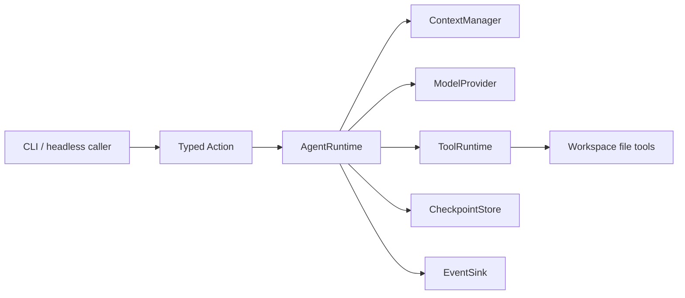
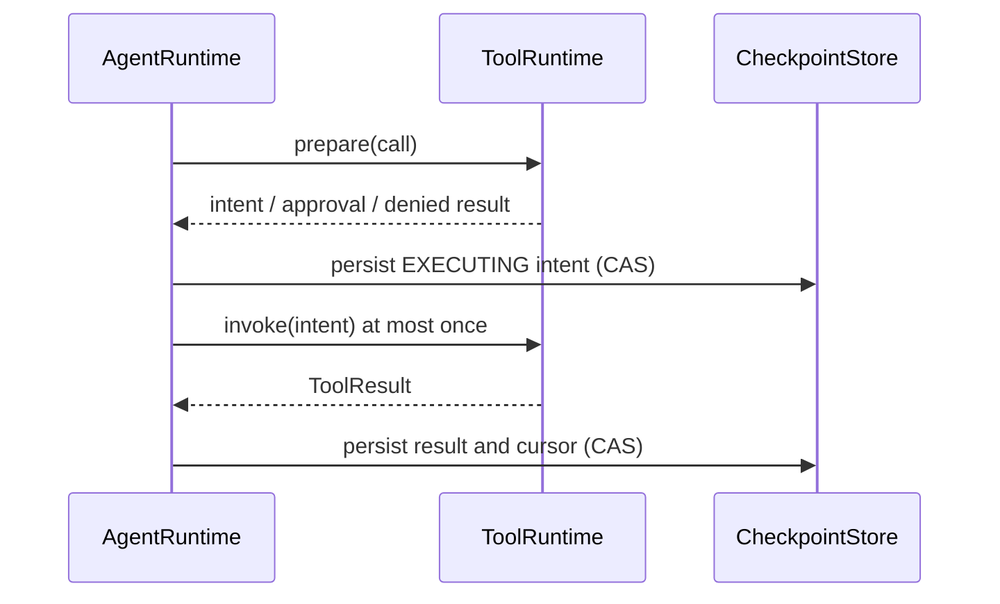

# Runtime Kernel Architecture

## 目标

Kernel v1 保护的是几个长期稳定的所有权边界，而不是预装尽可能多的功能：

1. `AgentRuntime.run_turn` 是唯一状态变更和模型循环入口。
2. `ContextManager` 是模型可见上下文的唯一决策者。
3. `ToolRuntime` 是工具解析、策略、审批绑定与 callable 调用的唯一入口。
4. `CheckpointStore` 在每个外部 effect 前后提供 CAS 和恢复边界。
5. `RuntimeEvent` 只负责通知；checkpoint 与 `RunResult` 才是事实来源。

## 单向依赖

- `runtime.contracts`：不可变数据合同，只依赖标准库。
- `runtime.state`：纯状态转换，只依赖叶子合同。
- `runtime.ports`：注入式行为接口。
- `runtime.context`、`runtime.tools`：各自拥有领域语义。
- `runtime.loop`：只依赖合同与 ports，不依赖具体 provider、CLI 或文件工具。
- `provider`、`runtime.checkpoint`、`runtime.events`、`agent.tools`：port adapter，不拥有循环。
- `main.py`：配置与 caller 入口；静态 assembly 已提取到 `agent/composition.py`：它显式构造唯一的 `KernelToolRuntime`、`KernelContextManager` 与 `AgentRuntime`，MCP closeables 进入 ordered close stack，Memory 以 immutable `ContextSource` 进入 sources tuple。二者不能演变成 service locator 或第二套 Runtime。

这个 DAG 防止某个新能力通过“临时调用”绕开主循环，最终演化成第二个 Agent。

对“caller 只提交 typed Action”有一条已知的边界情形：`main.py` 的 `browser_profile_user_command`（CLI `/browser-profiles`）是本机用户主动触发的 operator-only 浏览器 profile 管理面，提供 create/list/revoke/clear；它直接调用 `BrowserProfileStore`，输出只含 opaque profile ID，不进入 conversation checkpoint。模型驱动的会话行为、browser takeover 的 complete/cancel，以及一切 provider/tool/state progression 仍只能通过 typed Action 进入唯一的 `AgentRuntime.run_turn`：该管理面不暴露给模型，不是 tool 或 approval 的自授权路径，不能推进 Goal、调用 provider 或进入 `ToolRuntime`。因此它是“所有 CLI 输入都只是 typed conversation action”的明确限定，而不是模型权限绕过；它也不是通用桌面管理面，本切片不把它重写为新的 runtime action。

## 一次工具 effect 的顺序

`prepare` 不得调用工具。需要审批时，request 会绑定工具版本、策略、参数、目标、旧内容前置条件和新内容摘要；任何变化都会使旧审批失效。若进程在 `EXECUTING` 后无法证明结果已持久化，Runtime 进入 `AWAITING_RECOVERY`，不会自动重试副作用。

`ContinuationPhase.EXECUTING` 也是共享 action legality 的安全边界：durable active run 处于该 phase 时，`CancelRun` 必须由 reducer 拒绝且 state 不变；所有 CLI/headless/TUI caller 都只能提交一次 `Resume`，让同一个 Runtime 生成 `AWAITING_RECOVERY` request。进入 `AWAITING_RECOVERY` 后只接受 exact `ResolveUnknownToolOutcome`，不能再用 Resume/Cancel 绕过分类。adapter 隐藏按钮不能替代这条 Kernel 合同。

前台 provider 阻塞期间，Runtime 可以向 caller 显式注入的独立 progress sink 直送 `MODEL_PROGRESS`
advisory（开始、真实等待秒数、返回），但它不进入普通 Runtime event 的锁后交付通道，也不推进 durable
state。TUI 的 `Ctrl-C` 只向当前 conversation/Goal revision/invocation 绑定的 `ControlInbox` 提交请求并立即
显示“等待安全边界”。精确 DeepSeek Flash SSE 路径在后续流读取边界观察该绑定请求并
协作关闭响应；其他 provider 无取消合同时不会伪装为已终止。真正的 `CANCELLED` 始终由同一个
Runtime 在安全边界落盘；adapter 不能直接修改 state。

文件写入默认仍逐笔审批。用户显式选择 task-scoped consent 时，Runtime 只把当前审批提升为当前
Goal/revision、workspace、同一文件工具和同一精确 Goal target，或 Goal 已明确列出的目录 target；它最多允许 16 次
实际执行并在批准后 60 分钟到期。每次使用在 `EXECUTING` checkpoint 中先持久化扣减；撤销、Goal 修订、
完成或取消都会清空授权。目录授权只能通过单独 typed action 创建，不会从文件自动推断父目录，也不能覆盖
`.git`、`.env`、凭据或密钥类路径。到期、耗尽或任一 identity 不匹配时恢复逐笔审批，不能由模型续期或扩大路径。

## 调用预算与收敛

`InvocationLimits` 的 model/tool/input/output 累计上限是 caller 可选的暂停策略；显式整数仍产生可恢复的
`PAUSED_LIMIT`，`None` 表示该 invocation 不按局部分片中断。Everyday composition 不再使用八次的 invocation
分片，但为同一 durable run 保留 40 次发送前硬上限和 2 小时墙钟上限；`/resume` 或进程重启不会重置。
墙钟到界会在下一笔 provider/tool effect 前暂停；已经处于 unknown/persisted recovery 的结果仍先安全归类。
需要跨 parent/child/压缩共同
约束真实 HTTP 请求时，caller 还必须显式配置同一 `TransportAttemptLedger` 与 `--max-model-attempts`。因此一个
仍在产生新事实、改变策略或完成子目标的普通任务不会只因旧的八次分片要求用户反复 `/resume`，同时也不会获得
无限请求权。这不取消单次 `ContextManager` 窗口、provider 单次输出、工具 I/O、deadline、checkpoint 容量或
effect approval 的有限边界。

协议/结构错误与任务停滞是两个独立熔断器。`max_invalid_repairs` 约束无法严格归一化或不合法的 control；
`max_no_progress_replans` 只累计连续独立 model response 中语义相同的停滞指纹。一个已接纳的 tool batch 会继续
逐项执行和 checkpoint，但只有全部普通结果产生后才提供一次 replan opportunity；policy 或 no-progress pause 不得
插入这些结果之间。批次任意位置出现真实成功就重置停滞；全失败批次则按有序的稳定结果组合计数。换工具/参数/
错误原因或新增验证 evidence 同样重置停滞指纹。默认 Everyday 的 16 次相同停滞是紧急熔断，不是正常调用预算。
前台明确分类为 timeout、transport 或 unavailable 的瞬时 provider 故障最多自动重试两次，且失败请求照常计入
run/transport 预算；429、认证、额度、未分类错误和 background unknown outcome 不自动重试。

最终验证 evidence 还受事实顺序约束：一次成功的 process/sandbox 验证只能证明当时的候选；它之后如果又发生
文件写入、目录创建或新的 process/sandbox effect，Runtime 会把旧 process receipt 视为过期，要求重新验证后
才能进入 `VERIFIED_DONE`。这是缺少完整输入依赖图时的保守下界；它不能检测 Agent 外部并发修改，也不把单个
退出码解释为业务语义正确。

本地 Web 验收不放宽公网 browser policy。`managed_web_start` 仍经同一 ToolRuntime、exact process approval
和 `EXECUTING` checkpoint，返回的 opaque resource 将当前 Goal、批准命令、独立 process group 与唯一
`http://127.0.0.1:<port>` 绑定；browser 的每一次 document/redirect/subresource/WebSocket 请求都重新验证
该绑定。一个无模型/无工具权限的 POSIX 小监督器只负责父进程 EOF 与 hard lifetime 清组，不是第二套 Agent
loop、daemon 或登录项。active start/open receipt 在 stop/close 前不可被 compaction 删除，也会阻止
`VERIFIED_DONE`，因此清理不能只依赖模型的最终文字。
managed local-web 还要求宿主提供固定路径的 `lsof`，用于证明 loopback listener 确由批准的 process group
持有；缺失或无法确认 owner 时 fail closed，不退化成“端口能连就算本任务服务”。
`managed_web_start` 只暴露 closed `long`（900 秒）档位，因为服务需要跨越多轮模型思考和浏览器动作；
它仍由 task/composition 持有，达到 hard lifetime 或 close 时同步清组。

## 精确 DeepSeek Flash 协议记录（2026-09-13）

思考模式只对 `openai_compatible` + `https://api.deepseek.com` +
`/v1/chat/completions` + `deepseek-v4-flash` 开放，并固定 `thinking=enabled`、
`reasoning_effort=max`、`strict_tools=false`。DeepSeek 官方接口允许的输出上限较大，但这不会
暗中放大 First Agent 的预算；产品仍使用显式 `max_output_tokens`（默认 4096）。

该路径逐事件有界解析 SSE，只在完整 finish 和 `[DONE]` 后构造一次 `ModelResponse`。
公开文本增量是 advisory；思考片段和工具参数片段不进入事件/UI。断流、乱序、缺失 finish 或
`[DONE]` 不会铸造部分响应，也不自动重发已开始的请求。

`reasoning_content` 由不可变 `ProviderContinuationV1` 承载，绑定 provider identity 与内容摘要。
有历史 assistant 消息时，缺失、摘要不符或 provider 不匹配均在 HTTP 前 fail closed；Anthropic 投影
也拒绝该载体。它可随原 assistant/tool-call fact checkpoint/replay，但不进入展示、Memory 或
compaction summary。压缩移除的旧消息及其 continuation 一同移除；保留的最新消息继续保持身份绑定。

实现依据是 DeepSeek 官方
[`Thinking Mode`](https://api-docs.deepseek.com/zh-cn/guides/thinking_mode/)与
[`Create Chat Completion`](https://api-docs.deepseek.com/zh-cn/api/create-chat-completion/)。本记录只承诺这个精确组合，
不把其外推为任意 OpenAI-compatible endpoint 的推理或流式支持。

## 上下文管理

`KernelContextManager` 统一预算 system policy、当前输入、历史、未解决请求、工具 schema 与工具结果，并保留输出空间。裁剪是确定性的：先限制过大的工具结果，再按最旧的完整原子组淘汰；tool call 与对应 result 不会被拆开。固定核心仍装不下时，会在 provider 调用前返回 limit，而不是悄悄丢失安全事实。

长会话压缩走一条严格、无 capability 的内部路径：专用 compaction `ContextPack` 由 `KernelContextManager` 构建，模型 summary 经严格解析后写回，缩减 CAS 前先把完整原样 state 无损写入 archive（archive-before-reduction）。summary 是 untrusted data，只能作为上下文参考，不能重建 Goal、Evidence、Approval 或 Recovery。Memory v1 已按只读、不可变、受预算约束的 `ContextSource` 加 governed tools 接入；仍没有可执行的 Context Contributor 插件。

SubAgent 调查不另建 engine：同步和 process-isolated runner 都调用同一个 `AgentRuntime.run_turn`。child 的独立 ToolRuntime 只装配已有 workspace file registrations 的只读子集，父侧保留写入、验收和完成所有权。child checkpoint 中由 Kernel 铸造的 workspace receipt 在返回前按当前文件 snapshot/content digest 再验证；结果中的 path/line/digest 只作 advisory evidence，不提升为 parent authority。写入、process、network、Memory、Skill、MCP 和再次 delegation 均不注册。父 Runtime 的 `ControlInbox` 只把与当前 conversation/Goal revision/invocation 精确绑定的控制请求投影成 process runner 的只读取消观察器；开始前取消不启动 child，开始后由 parent 回收所拥有的 process group，并因远端调用可能已经发出而返回 `UNCONFIRMED`，不能伪装成无副作用终止。

## 持久化边界

本地 store 默认使用 owner-only state root，并按 workspace identity 确定性选择 session；`--state-root` 仅是 advanced override。store 仍使用 `0700` 目录、`0600` 文件、no-follow open、进程锁、snapshot token 和 revision CAS，不扫描、不迁移也不删除旧状态。

## 诚实边界

Kernel v1 已通过 fake 和 mocked HTTP 合同验证，但这不等同于“通用 Agent 已完成”或生产级沙箱。Python tool source 是 operator-trusted；对抗同 UID 进程的最终文件竞态、untrusted extension 隔离、精确 DeepSeek Flash 以外的流式/思考协议、模型 summary 的语义保真保证与本轮真实 provider dogfood 都不在当前承诺内。
